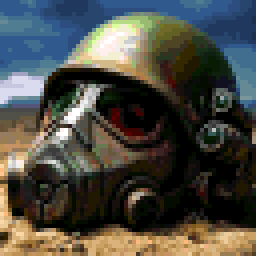

# FOC demo

FOC is a Fallout 2 mod set in West Texas. This demo is the game as it stands, with everything built so far:

- **Redwell**, the colony you arrive in: the well, the ruins down the east road, Kilgore's gecko hunt, the stash and the scavengers.
- **Clairemont**, the town to the northeast: the Marshal and his outlaw, the hanging set for noon, the refugee camp, the courthouse, and picture night at the drive-in.
- **The Facility**, which the dig under Redwell's ruins opens.
- **Lamesa**, the depot and its flock.
- **The Midland Ruins**, **Webb Airbase** and the **Relay Station**.
- **The fight for the well**, and what you decide with Callum after it.

Still being built: four of Midland's streets have nobody on them yet, the Relay Station's lower floors stay shut, and Odessa is not on the map.

## Download and play

1. Download **FOC-Demo-2026-11-22.zip** from [demo 0.6](../../releases/tag/v0.6-demo) (about 1.5 GB).
2. Unzip the whole folder anywhere. It doesn't need installing.
3. Run **Create Desktop Shortcut.bat** once for a desktop shortcut, or start **PLAY FOC.bat** (or `fallout2-ce.exe`) in the folder.
4. Start a new game. The earlier demos ran on another build and stopped after Clairemont; their saves are not meant for this one.

It runs full screen at 1920x1080. To change that, edit `f2_res.ini` in the folder: `SCR_WIDTH` and `SCR_HEIGHT` are the size, `WINDOWED=1` runs it in a window.

Saves go in `data\SAVEGAME` inside the folder.

## Conveniences in this build

Each is a line in `[Misc]` of `ddraw.ini`; set it to 0 to turn it off.

- Out of combat you walk through unlocked doors, and someone standing in your way steps aside.
- The music carries on when the next map plays the same track.
- The save and load screens open on your newest save.
- Seven buttons beside the item lists show one kind of item each (keys 1 to 7 work your own list).
- The map scrolls smoothly, and zooms in and out with the mouse wheel or Page Up and Page Down (End goes back to normal).

The game runs at 115% speed, and combat animations at twice their speed (`[Speed]` in `ddraw.ini`).

If it crashes it writes `crash.log` in its folder. Please send that along with what you were doing.

## What's in the download

A complete Fallout 2 folder with the Restoration Project (RPU 2.4.33) and FOC on top, run by FOC's build of the Fallout 2 Community Edition fork. This repository holds only this page, the icon and the shortcut maker; the game itself is the release download.

The earlier demos, which stop after Clairemont, are still on the [releases page](../../releases): 0.5 (Community Edition) and 0.4 (sfall and the Hi-Res Patch).

Private test build: please don't share it outside the people it was sent to.
