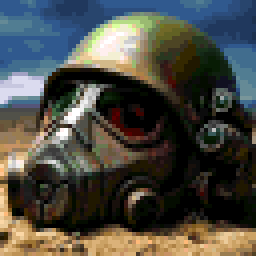

# FOC demo

FOC is a Fallout 2 mod set in West Texas. This demo covers its first two places:

- **Redwell**, the colony you arrive in: the well, the ruins down the east road, Kilgore's gecko hunt, the stash and the scavengers.
- **Clairemont**, the town to the northeast: the Marshal and his outlaw, the hanging set for noon, the refugee camp, the courthouse, and picture night at the drive-in.

The demo ends once you're back at Redwell from Clairemont. A box tells you so, and you can keep playing both places after that.

## Download and play

There are two builds of the same demo. Pick one; each keeps its own saves.

**Community Edition (newest):** FOC's own build of Fallout 2 CE, with extras the other build doesn't have.

1. Download **FOC-Demo-CE-2026-11-11.zip** from [demo 0.5, Community Edition](../../releases/tag/v0.5-ce-demo) (about 1.4 GB).
2. Unzip the whole folder anywhere. It doesn't need installing.
3. Run **Create Desktop Shortcut.bat** once for a desktop shortcut, or start **PLAY FOC CE.bat** (or `fallout2-ce.exe`) in the folder.
4. Start a new game.

It runs full screen at 1920x1080. To change that, edit `f2_res.ini` in the folder: `SCR_WIDTH` and `SCR_HEIGHT` are the size, `WINDOWED=1` runs it in a window.

**sfall and the Hi-Res Patch:** the original engine.

1. Download **FOC-Demo-2026-11-10.zip** from [demo 0.4](../../releases/tag/v0.4-demo) (about 1.4 GB).
2. Unzip the whole folder anywhere.
3. Run **Create Desktop Shortcut.bat** once, or start **PLAY FOC.bat** (or `fallout2.exe`) in the folder.
4. Start a new game.

It runs at 1920x1080 through the Hi-Res Patch. To change the resolution, run `f2_res_config.exe` in the folder.

Either way, saves go in `data\SAVEGAME` inside the folder.

## Only in the Community Edition build

Each is a line in `[Misc]` of `ddraw.ini`; set it to 0 to turn it off.

- Out of combat you walk through unlocked doors, and someone standing in your way steps aside.
- The music carries on when the next map plays the same track.
- The save and load screens open on your newest save.
- A filter by the item lists in the inventory, use-on, loot and barter screens (click the label or press Tab), and PUT ALL in the loot screen.
- PARTY in your inventory (or P) swaps items with a party member; Page Up and Page Down change member.
- The map scrolls smoothly, and zooms in and out with Page Up and Page Down or Alt and the mouse wheel (End goes back to normal).
- Lines spoken far away or behind walls lose letters; Perception hears further.
- In combat you and your party act one at a time, then everyone else at once.

If it crashes it writes `crash.log` in its folder. Please send that along with what you were doing.

## What's in the downloads

A complete Fallout 2 folder with the Restoration Project (RPU 2.4.33) and FOC on top, run by FOC's build of fallout2-ce in the Community Edition download, and by sfall and the Hi-Res Patch in the other. This repository holds only this page, the icon and the shortcut maker; the game itself is the release download.

Private test build: please don't share it outside the people it was sent to.
